

  

<h1 align="center">NoiZee ToyZ</h1>

  <b>SynTHBloK</b> modules for <a href="https://vcvrack.com">VCV Rack 2</a> by Liquid Nick 
  Synth voices, filters, drums, effects and tools, built for hard techno and acid.

  <a href="https://www.liquidnick.com">liquidnick.com</a>

## Free singles

Each one is its own plugin, free and open source under GPL-3.0. Click a module to open its repo.

<table>
<tr>
<td align="center" valign="top" width="25%"><a href="https://github.com/NoiZeeToyZ/SynTHBloK-Quad">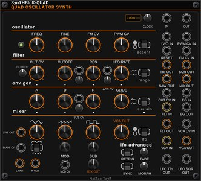 <b>QUAD</b></a> Four-oscillator synth voice: filter, envelope, glide, accent, LFO</td>
<td align="center" valign="top" width="25%"><a href="https://github.com/NoiZeeToyZ/SynTHBloK-Poly">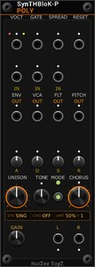 <b>Poly</b></a> Polyphonic unison engine</td>
<td align="center" valign="top" width="25%"><a href="https://github.com/NoiZeeToyZ/SynTHBloK-MorphFilter">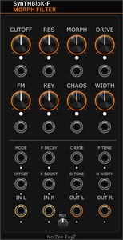 <b>Morph Filter</b></a> Drive into an LP-BP-HP morphing filter with FM and chaos drift</td>
<td align="center" valign="top" width="25%"><a href="https://github.com/NoiZeeToyZ/SynTHBloK-DualFilter">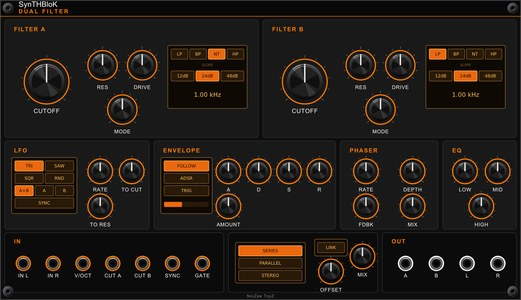 <b>Dual Filter</b></a> Two stereo multimode filters, LFO, envelope, phaser and EQ</td>
</tr>
<tr>
<td align="center" valign="top" width="25%"><a href="https://github.com/NoiZeeToyZ/SynTHBloK-Resonator">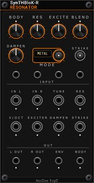 <b>Resonator</b></a> Stereo modal resonator: metal, wood, membrane, tube</td>
<td align="center" valign="top" width="25%"><a href="https://github.com/NoiZeeToyZ/SynTHBloK-CharacterDelay">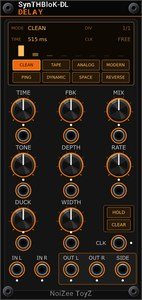 <b>Character Delay</b></a> Stereo delay with eight characters, from tape to reverse</td>
<td align="center" valign="top" width="25%"><a href="https://github.com/NoiZeeToyZ/SynTHBloK-GrainForge">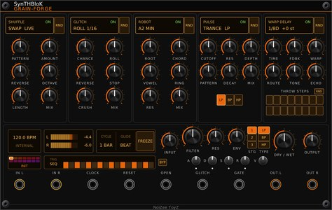 <b>GRAIN-FORGE</b></a> Clock-locked glitch, robot vocoder, gate and warp delay</td>
<td align="center" valign="top" width="25%"><a href="https://github.com/NoiZeeToyZ/SynTHBloK-StereoPhaser">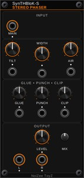 <b>Stereo Phaser</b></a> Width, tilt, air, glue, punch and clip with an analyzer</td>
</tr>
<tr>
<td align="center" valign="top" width="25%"><a href="https://github.com/NoiZeeToyZ/SynTHBloK-Kick">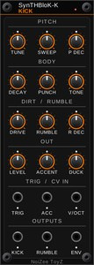 <b>Kick</b></a> Hard techno kick with a schranz rumble tail</td>
<td align="center" valign="top" width="25%"><a href="https://github.com/NoiZeeToyZ/SynTHBloK-SnareHat">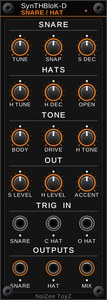 <b>Snare/Hat</b></a> Techno snare plus metallic open/closed hats</td>
<td align="center" valign="top" width="25%"><a href="https://github.com/NoiZeeToyZ/SynTHBloK-Euclid">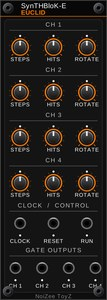 <b>Euclid</b></a> Four-channel Euclidean rhythm generator</td>
<td align="center" valign="top" width="25%"><a href="https://github.com/NoiZeeToyZ/SynTHBloK-MixFire">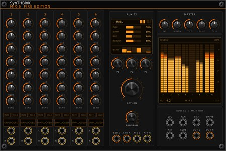 <b>MIX Fire Edition</b></a> 6, 8 and 12-channel stereo mixers with drive, air and glue</td>
</tr>
<tr>
<td align="center" valign="top" width="25%"><a href="https://github.com/NoiZeeToyZ/SynTHBloK-BloKMaster">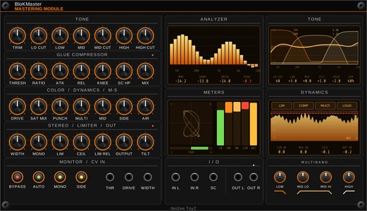 <b>BloKMaster</b></a> Mastering strip: EQ, glue, punch, limiter, stereo tools</td>
<td align="center" valign="top" width="25%"><a href="https://github.com/NoiZeeToyZ/SynTHBloK-PlayerPlus">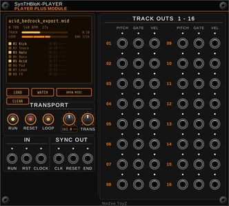 <b>Player Plus</b></a> MIDI file player with a watch folder and piano-roll view</td>
<td align="center" valign="top" width="25%"><a href="https://github.com/NoiZeeToyZ/SynTHBloK-JamProbe">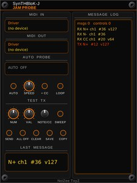 <b>JAM Probe</b></a> MIDI monitor and test sender for mapping controllers</td>
<td align="center" valign="top" width="25%"><a href="https://github.com/NoiZeeToyZ/SynTHBloK-Blanks">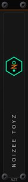 <b>Blanks</b></a> NoiZee ToyZ blank panels, 1 to 32 HP</td>
</tr>
<tr>
<td align="center" valign="top" width="25%"><a href="https://github.com/NoiZeeToyZ/SynTHBloK-MTX8">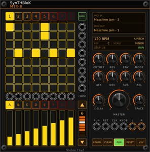 <b>MTX-8</b></a> 8x8 groovebox with 8 synth voices, in key, random grooves</td>
<td align="center" valign="top" width="25%"><a href="https://github.com/NoiZeeToyZ/SynTHBloK-Pulse">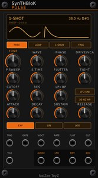 <b>PULSE</b></a> Triggerable LFO / VCA voice: sub kicks, flutter bass, pads, slow modulation</td>
<td align="center" valign="top" width="25%"><a href="https://github.com/NoiZeeToyZ/SynTHBloK-MTX1">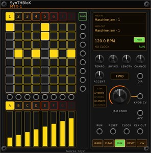 <b>MTX-1</b></a> 8x8 trigger sequencer + touch-strip CV for the Maschine JAM</td>
</tr>
</table>

## VST3 plugins

NoiZee ToyZ instruments and effects for your DAW (Windows VST3, Mac VST3 and AU). Downloads and the TOYBOX demo on the [VST3 page](https://noizeetoyz.liquidnick.com/vst.html).

<table>
<tr>
<td align="center" valign="top" width="25%"><a href="https://noizeetoyz.liquidnick.com/vst.html">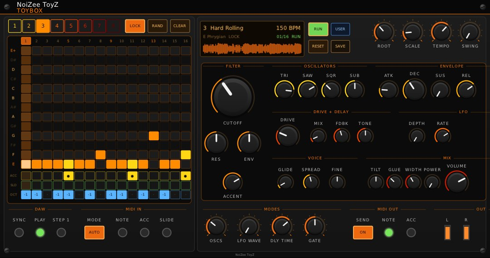 <b>TOYBOX</b></a> Acid synth with a step sequencer, as a VST3 (paid, $20, free demo)</td>
<td align="center" valign="top" width="25%"><a href="https://noizeetoyz.liquidnick.com/vst.html">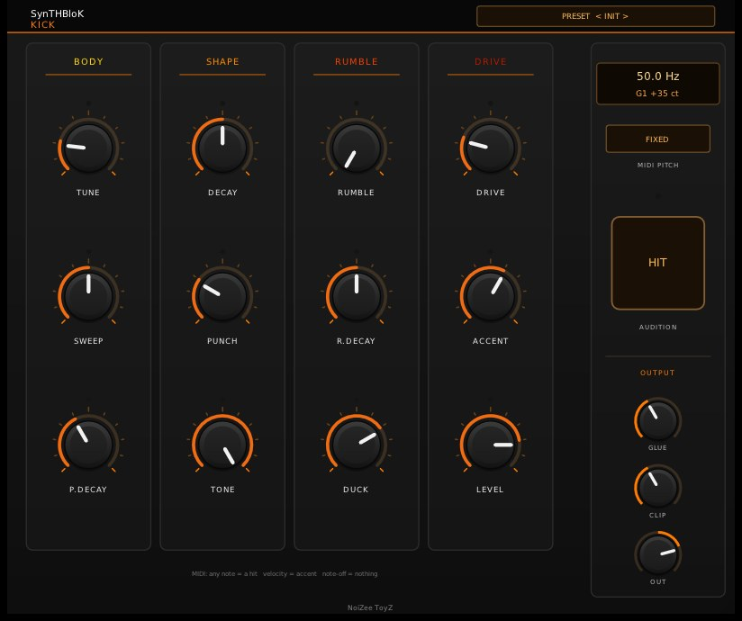 <b>KICK</b></a> Hard techno kick voice (free)</td>
<td align="center" valign="top" width="25%"><a href="https://noizeetoyz.liquidnick.com/vst.html">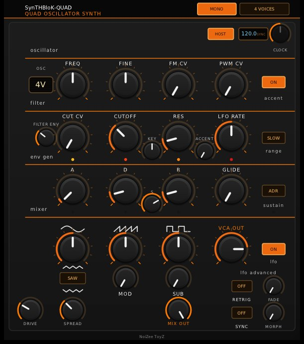 <b>QUAD</b></a> The QUAD synth voice (free)</td>
<td align="center" valign="top" width="25%"><a href="https://noizeetoyz.liquidnick.com/vst.html">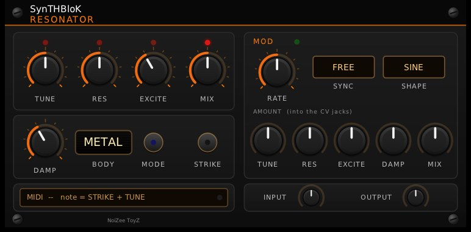 <b>RESONATOR</b></a> Modal resonator (free)</td>
</tr>
<tr>
<td align="center" valign="top" width="25%"><a href="https://noizeetoyz.liquidnick.com/vst.html">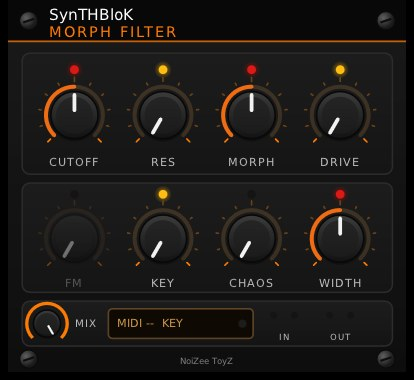 <b>MORPH FILTER</b></a> Drive into a morphing filter (free)</td>
<td align="center" valign="top" width="25%"><a href="https://noizeetoyz.liquidnick.com/vst.html">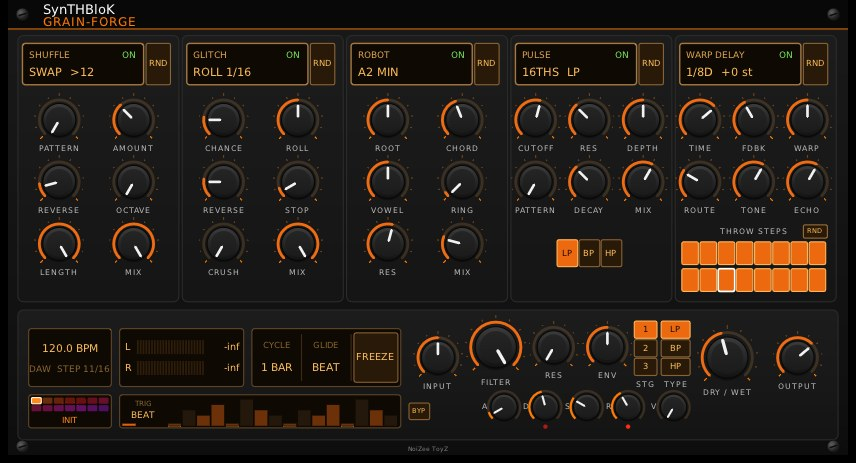 <b>GRAIN-FORGE</b></a> Clock-locked effects chain (free)</td>
<td align="center" valign="top" width="25%"><a href="https://noizeetoyz.liquidnick.com/vst.html">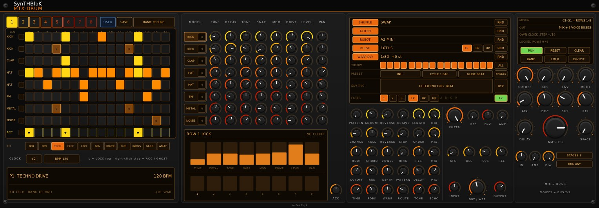 <b>MTX-DRUM</b></a> Drum-synth groovebox with FORGE FX: coming soon</td>
</tr>
</table>

## The NoiZee ToyZ pack: coming soon to the VCV Library

The full MTX groovebox system as one paid plugin: grooveboxes for the Maschine JAM, a song composer, the RANDROYD track generator, BACKDROP and more. Sets will be sold through the VCV Library. MTX-1, MTX-8 and PULSE above are already free. Details on the [pack page](https://noizeetoyz.liquidnick.com/pack.html).

<table>
<tr>
<td align="center" valign="top" width="25%"><a href="https://noizeetoyz.liquidnick.com/pack.html#m-mtx-forge">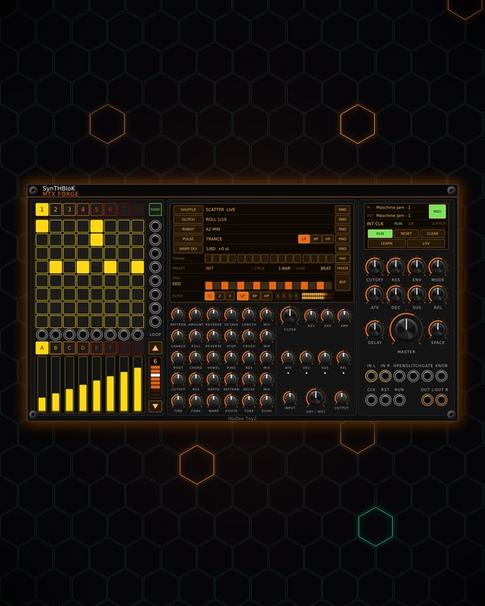 <b>MTX FORGE</b></a> A groovebox built around the Maschine JAM</td>
<td align="center" valign="top" width="25%"><a href="https://noizeetoyz.liquidnick.com/pack.html#m-mtx-duo">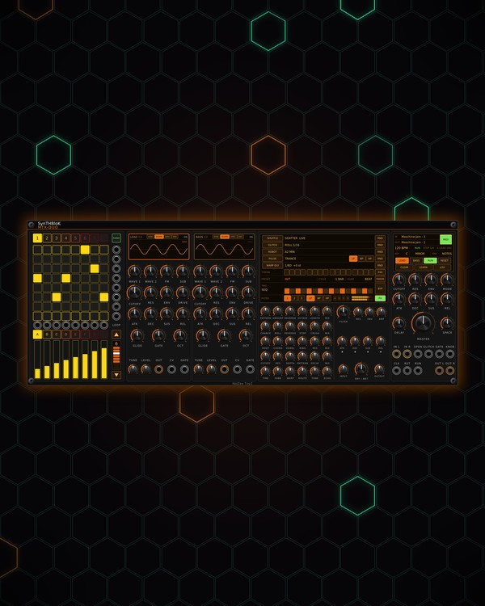 <b>MTX-DUO</b></a> Two mono synths, LEAD and BASS, in one panel</td>
<td align="center" valign="top" width="25%"><a href="https://noizeetoyz.liquidnick.com/pack.html#m-mtx-drum">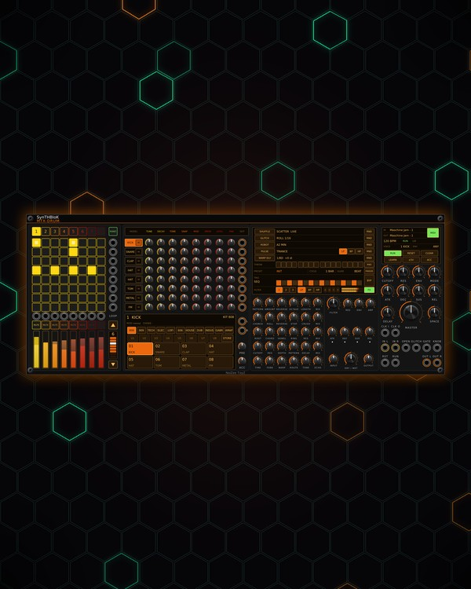 <b>MTX-DRUM</b></a> A drum-synth groovebox</td>
<td align="center" valign="top" width="25%"><a href="https://noizeetoyz.liquidnick.com/pack.html#m-mtx-quad">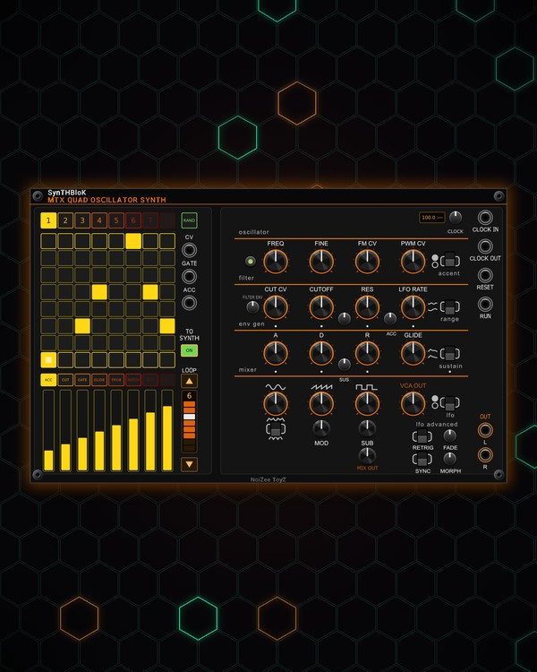 <b>MTX QUAD</b></a> The QUAD synth voice played by an 8x8 note grid</td>
</tr>
<tr>
<td align="center" valign="top" width="25%"><a href="https://noizeetoyz.liquidnick.com/pack.html#m-mtx-fx">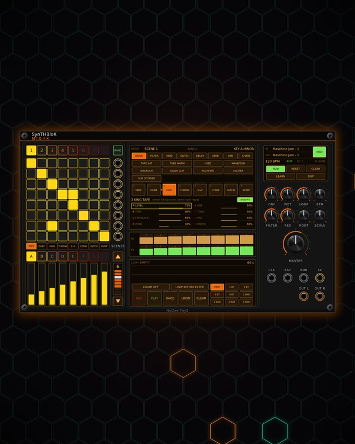 <b>MTX-FX</b></a> An eight-input effects matrix you play from the MTX 8x8 grid and the Maschine JAM</td>
<td align="center" valign="top" width="25%"><a href="https://noizeetoyz.liquidnick.com/pack.html#m-mtx-echo">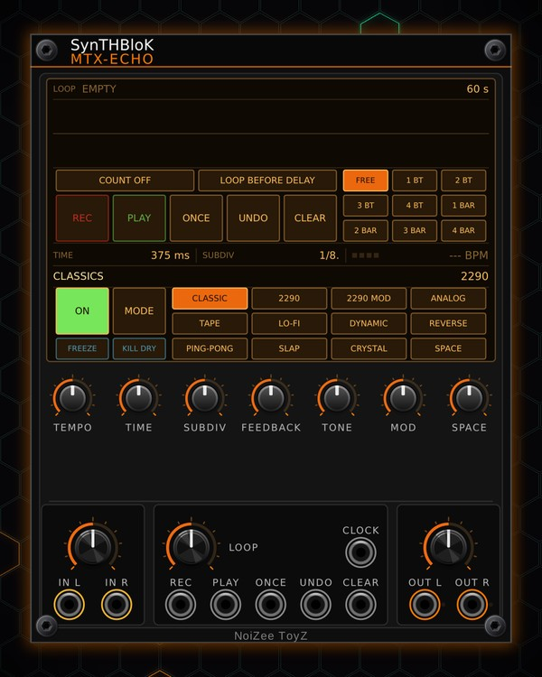 <b>MTX-ECHO</b></a> A stereo delay with twelve types, from the MTX ping-pong and clean digital to analog, tape, lo-fi, ducking, reverse, slap, octave shimmer and a multi-head space echo</td>
<td align="center" valign="top" width="25%"><a href="https://noizeetoyz.liquidnick.com/pack.html#m-mtx-loop">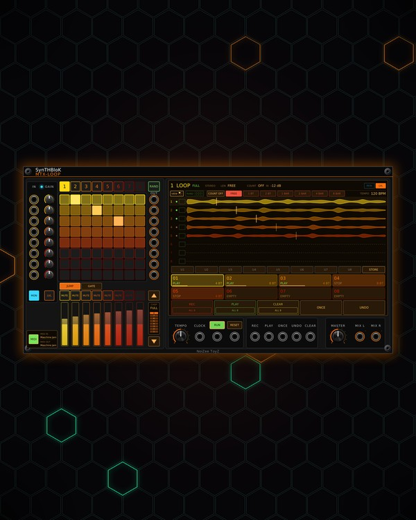 <b>MTX-LOOP</b></a> An eight-track loop sampler built on the MTX-ECHO looper</td>
<td align="center" valign="top" width="25%"><a href="https://noizeetoyz.liquidnick.com/pack.html#m-glitch-echo">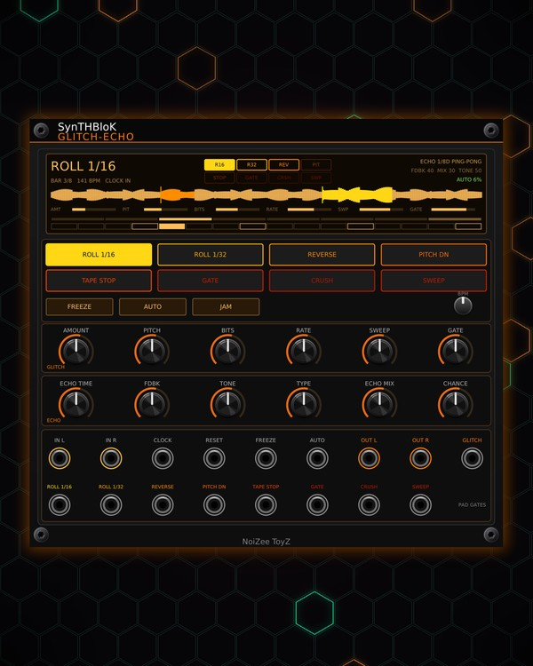 <b>GLITCH-ECHO</b></a> Tempo-locked glitch and echo</td>
</tr>
<tr>
<td align="center" valign="top" width="25%"><a href="https://noizeetoyz.liquidnick.com/pack.html#m-grit">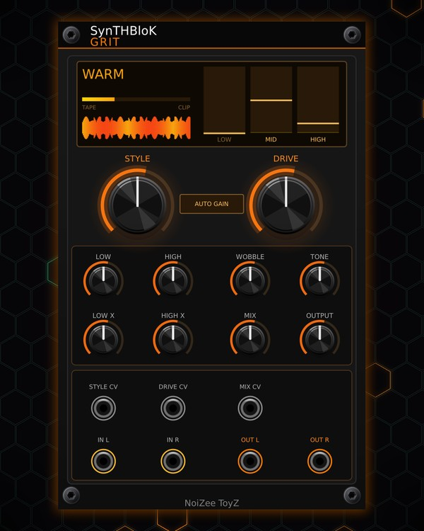 <b>GRIT</b></a> A three-band saturator for the mids</td>
<td align="center" valign="top" width="25%"><a href="https://noizeetoyz.liquidnick.com/pack.html#m-mtx-composer">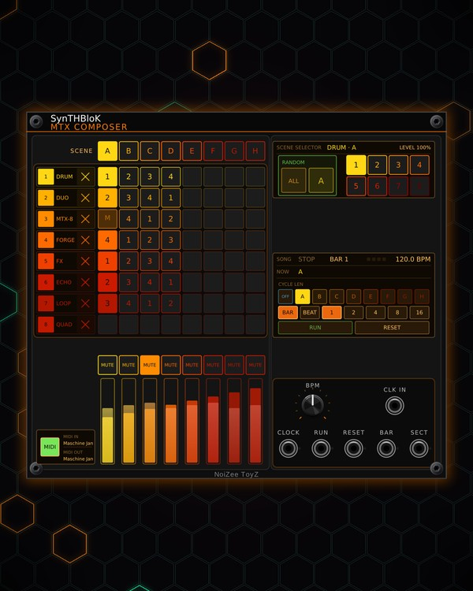 <b>MTX COMPOSER</b></a> The conductor for the MTX series</td>
<td align="center" valign="top" width="25%"><a href="https://noizeetoyz.liquidnick.com/pack.html#m-clokworx">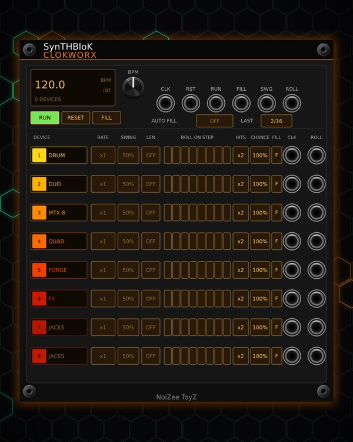 <b>CLOKWORX</b></a> A clock for up to eight devices</td>
<td align="center" valign="top" width="25%"><a href="https://noizeetoyz.liquidnick.com/pack.html#m-symphonics">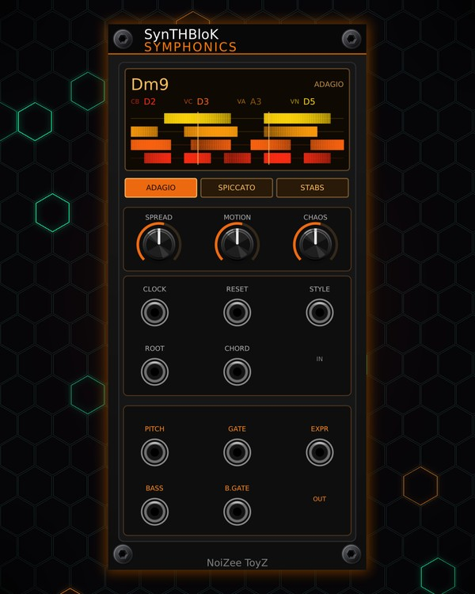 <b>SYMPHONICS</b></a> A four-voice orchestral layer: contrabass, cello, viola and violin</td>
</tr>
<tr>
<td align="center" valign="top" width="25%"><a href="https://noizeetoyz.liquidnick.com/pack.html#m-morph">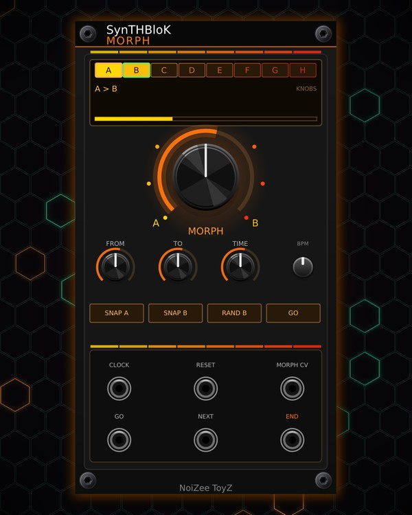 <b>MORPH</b></a> One knob for the whole rig</td>
<td align="center" valign="top" width="25%"><a href="https://noizeetoyz.liquidnick.com/pack.html#m-randroyd">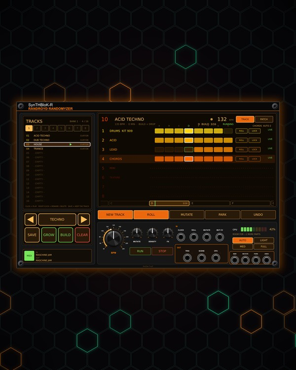 <b>RANDROYD</b></a> A track generator: writes whole songs across the MTX modules</td>
<td align="center" valign="top" width="25%"><a href="https://noizeetoyz.liquidnick.com/pack.html#m-patch-gen">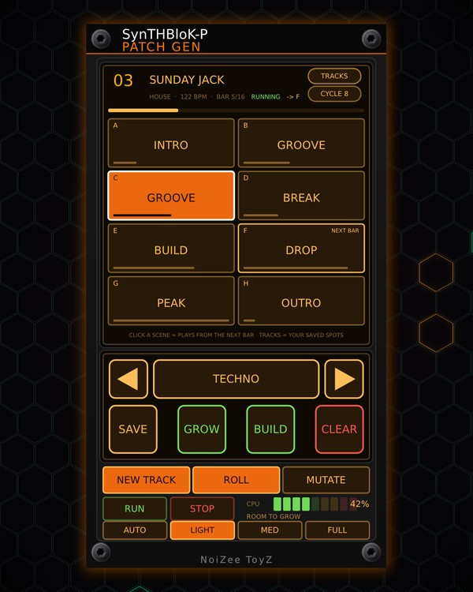 <b>PATCH GEN</b></a> The liquidnick.com PATCH GEN inside Rack</td>
<td align="center" valign="top" width="25%"><a href="https://noizeetoyz.liquidnick.com/pack.html#m-backdrop">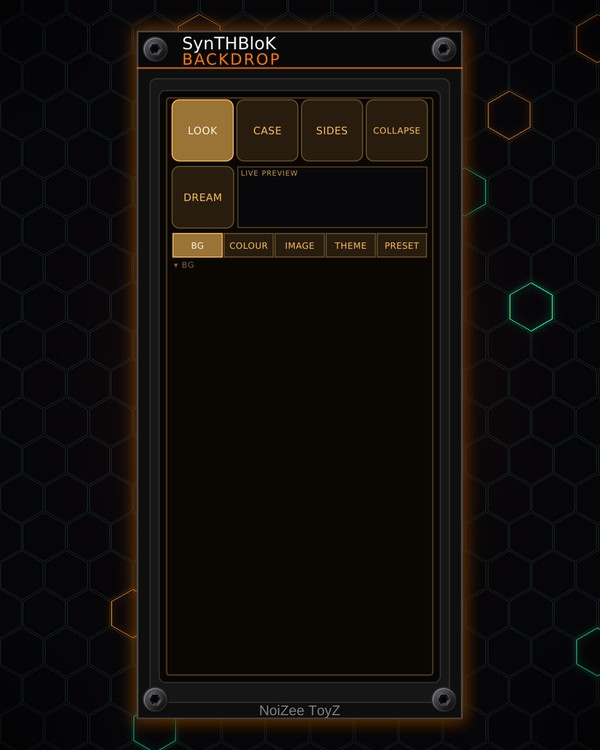 <b>BACKDROP</b></a> Dresses the whole rack: backgrounds, a case, side panels or rack ears</td>
</tr>
<tr>
<td align="center" valign="top" width="25%"><a href="https://noizeetoyz.liquidnick.com/pack.html#m-dream-lab">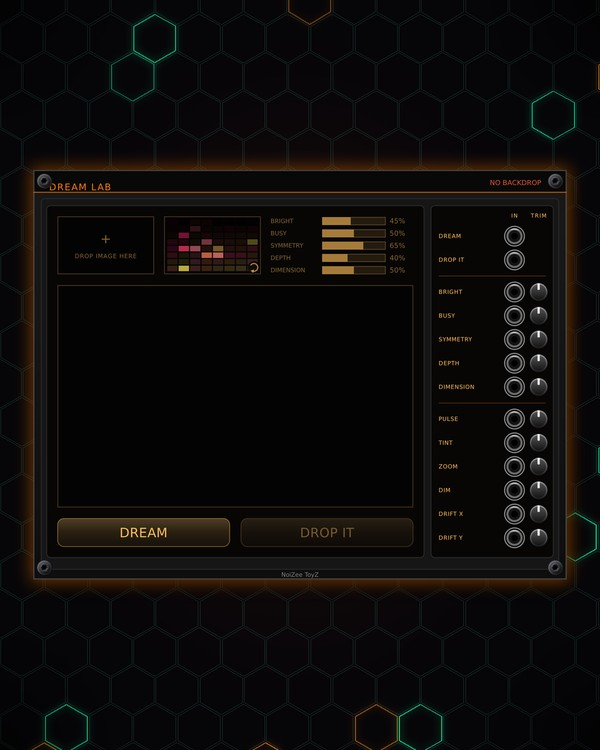 <b>DREAM LAB</b></a> A BACKDROP expander that dreams up new backgrounds</td>
</tr>
</table>

More news at [noizeetoyz.liquidnick.com](https://noizeetoyz.liquidnick.com) and [liquidnick.com](https://www.liquidnick.com).
