

  

<h1 align="center">NoiZee ToyZ</h1>

  <b>SynTHBloK</b> modules for <a href="https://vcvrack.com">VCV Rack 2</a> by Liquid Nick 
  Synth voices, filters, drums, effects and tools, built for hard techno and acid.

  <a href="https://www.liquidnick.com">liquidnick.com</a>

## Free singles

Each one is its own plugin, free and open source under GPL-3.0. Click a module to open its repo.

<table>
<tr>
<td align="center" valign="top" width="25%"><a href="https://github.com/NoiZeeToyZ/SynTHBloK-Quad">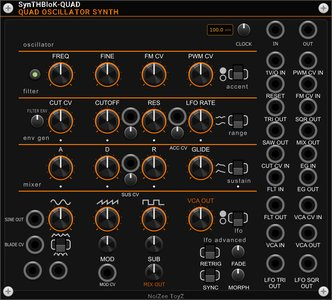 <b>QUAD</b></a> Four-oscillator synth voice: filter, envelope, glide, accent, LFO</td>
<td align="center" valign="top" width="25%"><a href="https://github.com/NoiZeeToyZ/SynTHBloK-Poly">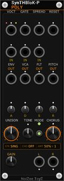 <b>Poly</b></a> Polyphonic unison engine</td>
<td align="center" valign="top" width="25%"><a href="https://github.com/NoiZeeToyZ/SynTHBloK-MorphFilter">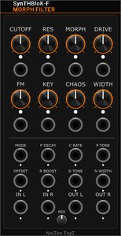 <b>Morph Filter</b></a> Drive into an LP-BP-HP morphing filter with FM and chaos drift</td>
<td align="center" valign="top" width="25%"><a href="https://github.com/NoiZeeToyZ/SynTHBloK-DualFilter">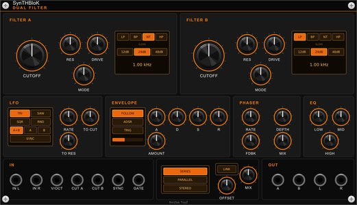 <b>Dual Filter</b></a> Two stereo multimode filters, LFO, envelope, phaser and EQ</td>
</tr>
<tr>
<td align="center" valign="top" width="25%"><a href="https://github.com/NoiZeeToyZ/SynTHBloK-Resonator">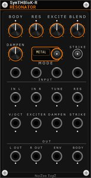 <b>Resonator</b></a> Stereo modal resonator: metal, wood, membrane, tube</td>
<td align="center" valign="top" width="25%"><a href="https://github.com/NoiZeeToyZ/SynTHBloK-CharacterDelay">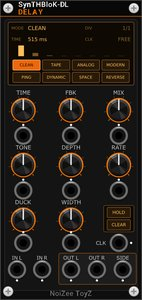 <b>Character Delay</b></a> Stereo delay with eight characters, from tape to reverse</td>
<td align="center" valign="top" width="25%"><a href="https://github.com/NoiZeeToyZ/SynTHBloK-GrainForge">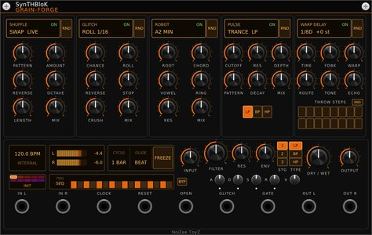 <b>GRAIN-FORGE</b></a> Clock-locked glitch, robot vocoder, gate and warp delay</td>
<td align="center" valign="top" width="25%"><a href="https://github.com/NoiZeeToyZ/SynTHBloK-StereoPhaser">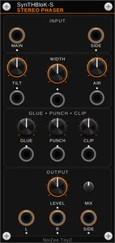 <b>Stereo Phaser</b></a> Width, tilt, air, glue, punch and clip with an analyzer</td>
</tr>
<tr>
<td align="center" valign="top" width="25%"><a href="https://github.com/NoiZeeToyZ/SynTHBloK-Kick">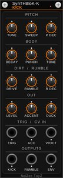 <b>Kick</b></a> Hard techno kick with a schranz rumble tail</td>
<td align="center" valign="top" width="25%"><a href="https://github.com/NoiZeeToyZ/SynTHBloK-SnareHat">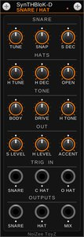 <b>Snare/Hat</b></a> Techno snare plus metallic open/closed hats</td>
<td align="center" valign="top" width="25%"><a href="https://github.com/NoiZeeToyZ/SynTHBloK-Euclid">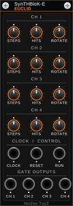 <b>Euclid</b></a> Four-channel Euclidean rhythm generator</td>
<td align="center" valign="top" width="25%"><a href="https://github.com/NoiZeeToyZ/SynTHBloK-MixFire">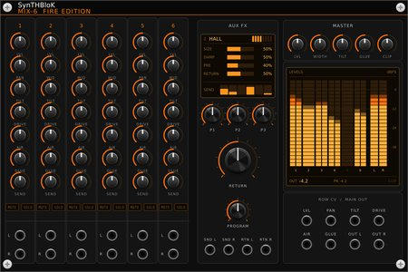 <b>MIX Fire Edition</b></a> 6, 8 and 12-channel stereo mixers with drive, air and glue</td>
</tr>
<tr>
<td align="center" valign="top" width="25%"><a href="https://github.com/NoiZeeToyZ/SynTHBloK-BloKMaster">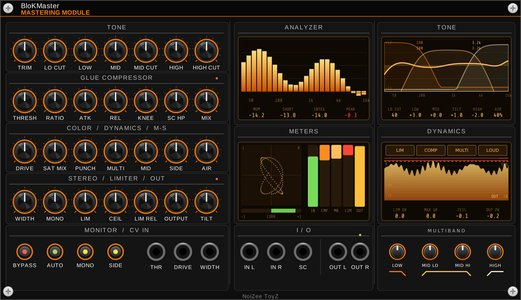 <b>BloKMaster</b></a> Mastering strip: EQ, glue, punch, limiter, stereo tools</td>
<td align="center" valign="top" width="25%"><a href="https://github.com/NoiZeeToyZ/SynTHBloK-PlayerPlus">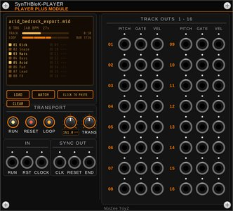 <b>Player Plus</b></a> MIDI file player with a watch folder and piano-roll view</td>
<td align="center" valign="top" width="25%"><a href="https://github.com/NoiZeeToyZ/SynTHBloK-JamProbe">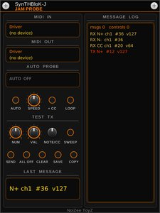 <b>JAM Probe</b></a> MIDI monitor and test sender for mapping controllers</td>
<td align="center" valign="top" width="25%"><a href="https://github.com/NoiZeeToyZ/SynTHBloK-Blanks">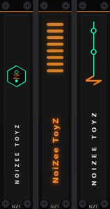 <b>Blanks</b></a> NoiZee ToyZ blank panels, 1 to 32 HP</td>
</tr>
</table>

## SynTHBloK MTX

The full MTX pack (grooveboxes for the Maschine JAM, a song composer, the RANDROYD track generator and BACKDROP) is a paid plugin. More news at [liquidnick.com](https://www.liquidnick.com).
